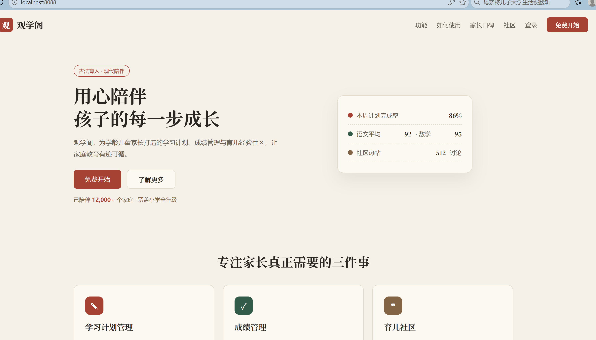
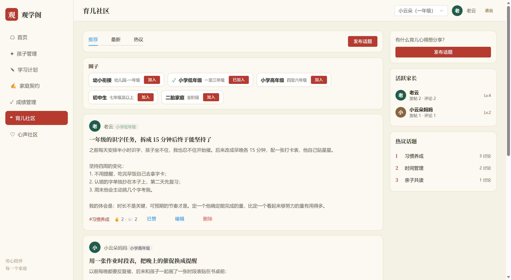
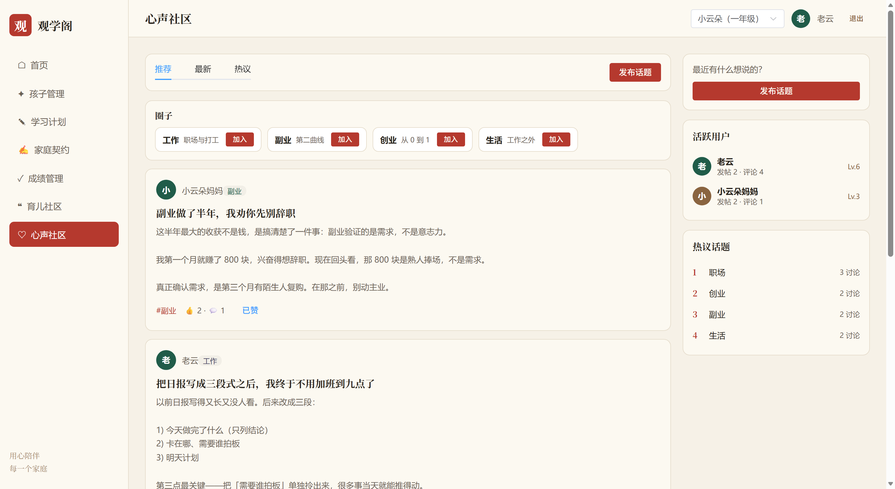

# 观学阁（GuanXueGe）· 产品文档

> **版本**：v3.2 ｜ **日期**：2026-10-18 ｜ **性质**：现状说明书（As-Built）
> **工程**：`D:\PROJECT\guanxuege-simple`（Spring Boot 单体 + Vue 3）
> **说明**：本文档基于**当前代码实际实现**编写，用于替换/补充早期 `docs/PRD.md`（v1.0，2026-08-01，描述的是已废弃的微服务架构版本）。凡代码与旧 PRD 冲突之处，**以本文档为准**。
>
> **v2.1 变更**：已修复原 9.1 节全部四个 P0 阻塞项 —— 点赞幂等、数据归属越权、JWT 密钥硬编码、家庭档案无法创建。
> 详见第 13 章，对应章节（6.1 / 7.5 / 9.1 / 11 / 附录 A）已同步更新。
>
> **v2.2 变更**：完成出包与本机 Docker 部署，数据库保持完好未重建；新增本机快速部署流程（10.2）、增量迁移目录 `backend/sql/migration/`、部署上线实测记录（13.5）。
>
> **v3.0 变更**：完成开源发布准备 —— 移除私钥等敏感信息、补 76 个单元测试、接入 GitHub Actions CI、
> 重写 README 并新增架构文档与 ADR。详见第 14 章。
>
> **v3.1 变更**：补入界面实拍（`docs/screenshots/`），新增 8.2 节图文对照；README 顶部加入预览区。
> 原 8.2–8.4 顺延为 8.3–8.5。
>
> **v3.2 变更**：新增 **M7 心声社区**（工作/副业/创业/生活，复用帖子能力经 `community` 维度切分）与
> **M8 用户资料**（社区昵称、联系方式仅本人可见、@提及）。表数 15 → 16，测试 76 → 153。
> 同步更新第二 / 六 / 七 / 八章。

---

## 一、产品概述

### 1.1 定位

观学阁是一款面向**学龄儿童家长**的一站式育儿与学业管理 Web 产品。它把三类场景收敛成一件事：

> **一个产品，把「规划 — 执行 — 记录 — 约定 — 交流」串成闭环。**

- **学业管理**：给孩子制定学习计划，逐日打卡执行；录入考试成绩，看趋势与得分率。
- **亲子约定**：用「家庭契约」把家长与孩子的双向承诺写下来，明确奖励与违约。
- **经验社区**：在分层圈子里发帖、评论、互动，把别人的经验转成自己的行动计划。
- **合规底线**：围绕儿童个人信息保护做前置同意与审计留痕（这是本产品区别于同类工具的重要设计）。

### 1.2 目标用户

| 用户类型 | 画像 | 核心诉求 |
|---|---|---|
| 主要用户：家长 | 25–45 岁，孩子 6–15 岁（小学至初中） | 省心管学习、看懂成绩、找到靠谱经验、缓解育儿焦虑 |
| 次要用户：孩子（被管理者） | 学龄儿童 | 在家长引导下参与计划执行与契约确认（本版本以家长视角为主） |

### 1.3 核心价值主张

| # | 主张 | 承载功能 |
|---|---|---|
| 1 | **陪伴可执行** | 学习计划 + 每日任务打卡 + 连续打卡天数 |
| 2 | **进步可量化** | 成绩录入 + 各科得分率 + 趋势对比 |
| 3 | **约定有凭据** | 家庭契约（双向承诺 / 奖励 / 违约 / 孩子确认） |
| 4 | **经验可复用** | 社区帖子 → **一键转成学习计划** |
| 5 | **焦虑被接住** | 反焦虑护栏：违禁词拦截 + 焦虑词温和提醒 |
| 6 | **儿童信息受保护** | 监护人声明 + 专项同意 + 可撤回 + 审计留痕 |

---

## 二、功能架构总览

```
观学阁
│
├─ M0 账号与合规（支撑模块）
│   ├─ 手机+密码注册/登录（JWT）
│   ├─ 注册时强制勾选《用户协议》《隐私政策》
│   └─ 同意记录：登记 / 撤回 / 查询（审计留痕）
│
├─ M1 品牌落地页（免登录）
│   └─ Hero / 功能三卡 / 三步流程 / 数据背书 / 家长口碑 / CTA
│
├─ M2 家庭与孩子档案
│   ├─ 家庭档案：家庭昵称 / 家庭类型 / 家风宣言（一家长一份）
│   └─ 孩子档案：姓名 / 年级 / 学校 / 头像 / 生日 / 性别 / 性格 / 兴趣
│
├─ M3 学习计划 ★核心
│   ├─ 计划：标题 / 说明 / 类型(日·周·月) / 起止日期 / 状态 / 进度
│   ├─ 任务：标题 / 科目 / 截止日 / 状态 / 进度
│   ├─ 打卡：每日一次 + 备注
│   └─ 看板：待开始 / 进行中 / 已完成 三列
│
├─ M4 成绩管理
│   ├─ 成绩：科目 / 考试名称 / 得分 / 满分 / 日期 / 班排名 / 评语
│   └─ 概览：总平均分 + 各科平均分 + 得分率柱状图 + 科目明细
│
├─ M5 家庭契约
│   └─ 标题 / 孩子承诺 / 家长承诺 / 奖励 / 违约 / 孩子确认 / 达成·违约
│
├─ M6 育儿社区 ★核心（community = parenting）
│   ├─ 分层圈子：幼小衔接 / 小学低年级 / 小学高年级 / 初中生 / 二胎家庭
│   ├─ 帖子：标题 / 正文 / 图片 / 话题标签 / 所属圈子
│   ├─ 互动：点赞 / 评论（带图）/ 编辑·删除（限本人）
│   ├─ 榜单：活跃家长榜 / 热议话题榜（均按社区独立统计）
│   ├─ 内容治理：违禁词拦截 + 反焦虑护栏
│   └─ 转计划：帖子 → 一键生成学习计划 + 初始任务
│
├─ M7 心声社区 ★（community = voice，与 M6 共用同一套能力）
│   ├─ 圈子：工作 / 副业 / 创业 / 生活
│   ├─ 帖子 / 评论 / 点赞 / 编辑删除：完全复用 M6
│   └─ 榜单：活跃用户榜 / 热议话题榜（仅本社区数据）
│
├─ M8 用户资料 ★
│   ├─ 查看：点击头像或作者昵称打开资料卡
│   ├─ 自助编辑：账号昵称 / 社区昵称 / 微信号 / 邮箱 / 个性签名
│   ├─ 隐私：手机号·微信号·邮箱仅本人可见，他人一律 null
│   └─ @提及：帖子与评论可 @ 系统用户，按昵称解析并高亮
│
└─ 基础设施
    ├─ 图片上传（发帖/评论粘贴上传）
    └─ 响应式：桌面 / 平板 / 移动三档适配
```

### 2.1 模块成熟度矩阵

| 模块 | 增 | 查 | 改 | 删 | 特殊动作 | 成熟度 |
|---|:-:|:-:|:-:|:-:|---|:-:|
| 账号 / 同意 | ✅ | ✅ | — | — | 协议勾选、撤回 | 可用 |
| 家庭档案 | ✅ | ✅ | ✅ | — | 家庭类型 / 家风宣言 | 可用（v2.1 修复创建缺陷） |
| 孩子档案 | ✅ | ✅ | ✅ | ✅ | 监护人同意前置 | 可用 |
| 学习计划 | ✅ | ✅ | ⚠️ | ⚠️ | 打卡、连续天数 | 可用（编辑/删除未开放） |
| 成绩 | ✅ | ✅ | ⚠️ | ✅ | 概览、得分率图 | 可用（后端支持改，前端未开） |
| 家庭契约 | ✅ | ✅ | ⚠️ | ✅ | 孩子确认、达成、违约 | 可用 |
| 社区帖子 | ✅ | ✅ | ✅ | ✅ | 点赞、转计划、@提及 | 可用 |
| 社区评论 | ✅ | ✅ | — | ✅ | 图片评论、@提及 | 可用 |
| 圈子 | — | ✅ | — | — | 加入 / 退出、按社区过滤 | 可用 |
| 话题榜 | — | ✅ | — | — | 实时聚合标签，按社区过滤 | 可用 |
| 心声社区 | ✅ | ✅ | ✅ | ✅ | 复用帖子能力，`community=voice` | 可用 |
| 用户资料 | — | ✅ | ✅ | — | 社区昵称、联系方式（仅本人） | 可用 |
| 活跃榜 | — | ✅ | — | — | 按社区独立统计 | 可用 |

> ⚠️ = 后端已实现但前端未接线，或存在使用阻塞。

---

## 三、技术架构

### 3.1 当前架构（单体）

```
浏览器 / 移动端
      │
      ▼
Vue 3 (Vite) ─── /api/** ──► 单体 Spring Boot :8080
                             │
             ┌───────────────┼───────────────┐
             ▼               ▼               ▼
        MySQL 8.0      Caffeine 缓存    本地磁盘 ./images
        (14 张表)      (userBrief)      (帖子/评论图片)
```

| 层 | 技术选型 |
|---|---|
| 前端 | Vue 3.4 + Vite 5 + Vue Router 4 + Pinia 2 + Axios + Element Plus 2.7 |
| 后端 | Spring Boot 3.2（Java 17）+ MyBatis-Plus |
| 鉴权 | JWT（HS256），`JwtAuthenticationFilter` 校验后注入 `X-User-Id` 请求头 |
| 缓存 | Caffeine 本地缓存（仅 `UserBrief`，10 分钟过期） |
| 持久层 | MySQL 8.0（utf8mb4）+ MyBatis-Plus 逻辑删除 |
| 部署 | Docker Compose（mysql / app / frontend）或 Nginx 反代 + systemd |

### 3.2 相对旧版（微服务）的简化

旧版本为 Spring Cloud 微服务，现已在 `guanxuege-simple` 中重构为单体：

| 能力 | 旧版（微服务） | 当前（单体） |
|---|---|---|
| 服务治理 | Nacos 注册中心 | ❌ 移除 |
| API 网关 | Spring Cloud Gateway | ❌ 移除，由应用内过滤器承担 |
| 服务间调用 | OpenFeign（community → auth） | ✅ 同进程直接调用 `UserService` |
| 消息中间件 | RocketMQ（POST_CREATED 事件） | ✅ 改为同步落库（发帖即写热度） |
| 缓存 | Redis（验证码/黑名单/热度/幂等） | ⚠️ 降级为 Caffeine 本地缓存 |
| 鉴权位置 | 网关全局过滤器 | 应用内 `JwtAuthenticationFilter` |

**重构带来的能力退化**（需在后续版本中评估补回）：
- 点赞幂等丢失（详见 9.1）
- 发帖异步削峰变为同步
- Redis 去重/计数能力缺失

---

## 四、模块详细说明

### M0 账号与合规

**注册流程**
1. 前端校验手机号格式 `/^1\d{10}$/`、密码必填、昵称必填
2. 必须勾选《用户协议》《隐私政策》《儿童个人信息保护规则》
3. 后端校验 `privacyAgreed == true`，否则拒绝注册
4. 密码 BCrypt 加盐存储（**不明文、不 MD5**）
5. 落库后**自动写入一条 `USER_REGISTER` 同意记录**（childId = null，版本 1.0）
6. 注册成功后前端自动再调一次登录接口换取 token

**登录**
- 手机号 + 密码 → 校验 → 签发 JWT（**有效期 2 小时**）
- 返回 `{ token, user }`
- 账户 `status = 0` 时拒绝登录（"账户已被禁用"）

**同意记录（合规核心）**

| consent_type | 含义 | 触发时机 | 关联孩子 |
|---|---|---|---|
| `USER_REGISTER` | 用户协议 / 隐私政策同意 | 注册 | 否（null） |
| `CHILD_INFO` | 儿童个人信息专项同意 | 添加孩子 | 是 |

- **添加孩子是强同意门禁**：未勾选同意或未声明监护关系，后端直接抛错拒绝
- **删除孩子会自动撤回**该孩子的 `CHILD_INFO` 同意（`agreed` 置 0 + 记录 `withdrawn_at`）
- 撤回是**软操作**：保留审计轨迹，不物理删除

### M1 品牌落地页 `/`

免登录营销页，纯静态渲染，**不调用任何后端接口**。

区块：顶部导航（锚点）→ Hero + 水墨数据卡 → 功能三卡 → 三步流程 → 数据背书 + 家长口碑 → 底部 CTA → 页脚（含「湘ICP备2026034128号」备案链接）。

> ⚠️ 落地页上的运营数据（12,000+ 家庭、86% 完成率、4.8 评分、512 热帖）**全部为硬编码文案**，非真实统计。上线前必须替换为真实数据或改为中性表述。

### M2 家庭与孩子档案 `/app/children`

**家庭档案**（一家长一份，`uk_parent` 唯一约束）
- 字段：家庭昵称、家庭类型（核心家庭 / 二胎家庭 / 单亲家庭 / 隔代养育 / 其他）、家风宣言
- `PUT /api/family` 在无档案时会**自动创建**（后端是幂等容错设计）

**孩子档案**
- 字段：姓名*、年级、学校、头像、生日、性别、性格标签、兴趣标签
- **添加前置弹窗**：必须选择监护关系（父母 / 祖父母 / 其他监护人）+ 勾选《儿童个人信息保护规则》
- 删除时二次确认，并联动撤回同意

### M3 学习计划 `/app/plan` ★

**计划（Plan）**
- 字段：关联孩子、标题、说明、类型（DAY 日 / WEEK 周 / MONTH 月）、状态、起止日期、进度
- 状态：`0 待开始 → 1 进行中 → 2 已完成`
- 新建支持**批量任务**：文本框每行一条，前端串行调用创建接口

**任务（PlanTask）**
- 字段：所属计划、标题、科目（语文 / 数学 / 英语 / 科学 / 其他）、截止日、状态、进度、备注
- 各科目在前端有固定配色映射

**打卡（Checkin）★ 本模块最有价值的差异化能力**
- **每任务每日限一次**：数据库唯一键 `uk_task_date(task_id, checkin_date)`，重复打卡后端报错「今天已经打卡啦，明天继续加油」
- 打卡可填备注（≤200 字）
- 实时返回三项状态：
  - `checkedToday` — 今日是否已打卡
  - `streak` — **连续打卡天数**
  - `totalCount` — 累计打卡次数
- **连续天数算法**：若今天已打卡则从今天往前数，否则从**昨天**往前数（允许今天还没打但连续未断）

**概览卡片**：待开始数 / 进行中数 / 已完成数 / 整体完成率（= 已完成任务数 ÷ 总任务数 × 100）

**今日打卡汇总**：顶部汇总条显示待打卡任务数，点击弹窗可批量打卡。

**计划自動流轉**：对「待开始」计划下的任务打卡时，前端会先将该计划置为「进行中」。

### M4 成绩管理 `/app/grade`

**成绩记录（Grade）**
- 字段：关联孩子、科目、考试名称、得分、满分（默认 100）、考试日期、班级排名、**评语**
- 支持一位小数精度（DECIMAL(6,2)）

**概览分析**
- `overallAverage`：**各科平均分的平均值**（非所有原始分数的均值，注意口径）
- `subjectStats[]`：每科的 `average` / `fullScore` / `rate`（得分率%）/ `count`（考试次数）
- 前端以**纯 CSS 手写柱状图**展示各科得分率（未引入图表库）
- 科目明细卡 + 成绩明细表（含删除）

### M5 家庭契约 `/app/contract`

把亲子约定显性化、仪式化：

| 元素 | 说明 |
|---|---|
| 孩子的承诺 | 孩子要做什么 |
| 家长的承诺 | 家长要做什么（**双向约束是本模块的设计亮点**） |
| 达成奖励 | 做到了给什么 |
| 违约约定 | 没做到怎么办 |
| 孩子确认 | `child_confirm`：孩子是否已认可该契约 |
| 状态 | `0 进行中 / 1 已完成 / 2 已违约` |
| 有效期 | 起止日期 |

**生命周期**：创建（`child_confirm` 默认 0）→ 孩子确认 → 标记达成(1) 或 标记违约(2) → 删除

### M6 育儿社区 `/app/community` ★

**分层圈子（Circle）** — 按孩子学段分流内容，内置 5 个种子圈子：

| 圈子 | 适用阶段 | 标识色 |
|---|---|---|
| 幼小衔接 | 幼儿园-一年级 | `#E07A5F` |
| 小学低年级 | 一至三年级 | `#81B29A` |
| 小学高年级 | 四至六年级 | `#3D405B` |
| 初中生 | 七年级及以上 | `#8A6440` |
| 二胎家庭 | 全阶段 | `#B5392E` |

用户**手动加入/退出**，关系表 `gx_user_circle`（唯一键 `uk_user_circle`）。加入后可按圈子筛选信息流。

**信息流**
- 三个 Tab：`recommend`（按热度）/`latest`（按创建时间）/`hot`（按热度）
- ⚠️ 注意：`recommend` 与 `hot` **排序逻辑完全相同**（均为 `hot_score` 降序），实际只有两种排序
- 分页：`page` / `size`，默认 1 / 10

**热度计算**：新帖 `hot_score = 1`。

**点赞（幂等）**：关系表 `gx_post_like` 保证「一个用户对一个帖子最多一条记录」。
点赞 `hot_score + 1`，**再次调用视为取消点赞**并回退 `like_count` / `hot_score`。
帖子列表与详情会回填 `liked` 字段，前端据此展示「已赞 / 点赞」并支持取消。

> ✅ v2.1 修复：此前 `like()` 无幂等保护，重复调用可无限累加。

**发帖 / 编辑**
- 支持 3 套**提问模板**（求助问题 / 习惯养成 / 成绩提升），一键填充降低发帖门槛
- 支持 **Ctrl+V 粘贴图片**直接上传（9 图九宫格，可点击大图预览）
- 图片以 **JSON 数组字符串**存于 `images` 字段（VARCHAR 2000）
- 编辑、删除均**限本人**（后端强校验）

**话题榜 / 活跃家长榜**
- 热议话题：按帖子 `tag` **实时聚合**（帖子数 + 评论数），不再使用静态种子数据
- 活跃家长榜：按发帖数 + 评论数统计的**真实排行**（SQL 聚合）
- 两者均支持 `community` 参数，**按社区独立统计**——否则心声社区会看到育儿话题

**帖子 → 一键转计划 ★**
社区内容与个人执行的闭环。选择帖子 → 选孩子 → 生成计划（默认标题「《帖子标题》践行计划」）+ 任务列表，跳转至计划页。

**内容治理（反焦虑护栏）★ 产品差异化能力**

两级词库，策略不同：

| 级别 | 词例 | 策略 |
|---|---|---|
| **违禁词**（拦截） | 自杀、虐待、遗弃、人贩子、吸毒、赌博、傻逼…（共 16 个） | 直接拒绝发布，抛「内容包含不当词汇，请修改后再发布」 |
| **焦虑词**（标记放行） | 鸡娃、牛娃、内卷、躺平、输在起跑线、别人家孩子、成绩垫底…（共 14 个） | **允许发布**，但标记 `anxiety_flag = 1`，并返回温和提醒文案 |

焦虑词提醒文案示例：
> 你提到了「别人家孩子」，这个词容易放大焦虑。每个孩子都有自己的节奏，试着从具体的小事开始描述，更容易收获有用的建议。

命中后：
- 帖子详情顶部展示**暖色反焦虑护栏横幅**
- 发布后以温和弹窗提示，不阻断发布

该能力同时作用于**帖子正文/标题**与**评论内容**。

---

### M7 心声社区 `/app/voice` ★

与育儿社区**共用同一套帖子 / 评论 / 点赞 / @提及能力**，靠 `gx_post.community` 与 `gx_circle.community` 切分场景，不复制表结构。

**圈子（community = voice，内置 4 个）**

| 圈子 | 定位 | 标识色 |
|---|---|---|
| 工作 | 职场与打工 | `#4A6F8A` |
| 副业 | 第二曲线 | `#205C49` |
| 创业 | 从 0 到 1 | `#B5392E` |
| 生活 | 工作之外 | `#9B8A6F` |

**与育儿社区的差异**

| 维度 | 育儿社区 | 心声社区 |
|---|---|---|
| 圈子 | 5 个（按学段） | 4 个（按场景） |
| 发帖模板 | 求助 / 习惯养成 / 成绩提升 | 同一套组件，模板可配 |
| 右栏标题 | 活跃家长 | 活跃用户 |
| 「转为学习计划」 | ✅ 显示 | ❌ 不显示（与学习无关） |
| 榜单数据 | 仅 parenting | 仅 voice |

**实现要点**

- 后端：`community` 常量收敛在 `CommunityType`，非法值与 `null` 一律回落 `parenting`
- 前端：`Community.vue` 与 `VoiceCommunity.vue` 都是薄壳，实际渲染 `components/CommunityFeed.vue`，仅传入不同的 `community` 与文案配置

---

### M8 用户资料 `/api/user` ★

**查看**
- 顶栏头像 / 昵称、社区帖子作者、评论作者、活跃榜条目，点击均可打开资料卡
- 资料卡展示：头像、展示名、（他人视角的）签名、发帖数、评论数

**自助编辑**（仅本人）

| 字段 | 约束 | 说明 |
|---|---|---|
| 账号昵称 `nickname` | ≤ 50 字符 | 登录账号名，注册时的昵称 |
| 社区昵称 `community_nickname` | ≤ 30 字符 | **有值时代替账号昵称在社区展示**；留空即清除 |
| 微信号 `wechat` | ≤ 64 字符 | 仅本人可见 |
| 邮箱 `email` | 格式校验 + ≤ 64 字符 | 仅本人可见 |
| 个性签名 `signature` | ≤ 120 字符 | 公开可见 |

**隐私约定（重要）**

`UserProfileVO` 在服务端裁剪：手机号 / 微信号 / 邮箱**只有在「查看者 == 本人」时才填充**，他人查看一律为 `null`，前端展示为「仅本人可见」。

> 之所以在 VO 层做而不靠前端隐藏：前端不渲染 ≠ 数据不下发，响应体里照样能被抓包看到。

**展示名优先级**：`community_nickname` > `nickname`。改动后帖子、评论、活跃榜、@ 提及全部跟着变，登录账号不受影响。

**@提及**

- 帖子正文与评论正文中支持 `@昵称`，编辑器提供用户选择器（`GET /api/user/search`）
- 解析规则：`@` 后跟 1~30 个非空白、非中英文标点字符（含全角 `（）【】「」` 等）
- 昵称到用户的匹配**存 `user_id` 而非字符串**，用户改名后历史提及关系不失效
- `@` 了不存在的名字不报错，只是不产生提及关系
- 提及关系落 `gx_mention`，`uk_biz_user(biz_type, biz_id, user_id)` 防重
- 前端 `MentionText.vue` 负责高亮渲染

**当前限制**：仅记录提及关系，**未推送通知**（规划中）。

---

## 五、核心业务流程

### 5.1 注册登录

```
输入手机号+密码(+昵称，注册时勾选三份协议)
   → POST /api/auth/register
        ├─ 校验 privacyAgreed
        ├─ 校验手机号唯一
        ├─ BCrypt 加密密码落库
        └─ 写入 USER_REGISTER 同意记录
   → 前端自动 POST /api/auth/login
        ├─ 查询用户 + BCrypt 比对
        ├─ 校验账户未被禁用
        └─ 签发 JWT（2h）{ token, user }
   → 前端存 localStorage(gx_token / gx_user) + Pinia
   → 跳转 /app/plan
   → 后续请求 Header: Authorization: Bearer <token>
        → JwtAuthenticationFilter 校验 → 注入 X-User-Id → Controller
```

### 5.2 添加孩子（同意门禁）

```
点击「+ 添加孩子」
   → 强制弹窗：选择监护关系 + 勾选《儿童个人信息保护规则》
   → 填写孩子档案表单 → POST /api/child
        ├─ 后端校验 consentAgreed（未同意 → 拒绝）
        ├─ 后端校验 guardianRelation（未声明 → 拒绝）
        ├─ 校验姓名非空
        ├─ 写入 gx_child
        └─ 写入 gx_consent_record(CHILD_INFO, guardianRelation, version=1.0)
   → 孩子出现在档案网格 + 顶栏孩子切换下拉
```

### 5.3 制定并执行学习计划

```
新建计划(含每行一条的批量任务)
   → POST /api/plan → N× POST /api/plan/task
   → 看板按状态三列渲染（待开始/进行中/已完成）

每日执行：
   → 顶部「今日打卡」汇总条显示待打卡数
   → 任务行显示 🔥 连续 N 天
   → 点击打卡 → 弹窗填备注 → POST /plan/task/{id}/checkin
        ├─ 唯一键防重：今日已打卡则拒绝
        └─ 写入 gx_checkin(task_id, child_id, date, note)
   → 前端刷新打卡状态（今日已打 / 连续天数 / 累计次数）
   → 若计划仍为「待开始」，自动置为「进行中」
```

### 5.4 录入与分析成绩

```
POST /api/grade（科目/考试/得分/满分/日期/班排名/评语）
   → GET /api/grade/overview
        ├─ 按科目分组聚合
        ├─ 各科平均分 + 得分率(%)
        └─ 总平均分 = 各科平均分的均值
   → 前端渲染：概览卡 + 得分率柱状图 + 科目明细卡 + 明细表
```

### 5.5 社区发帖与互动

```
发帖
   → 选提问模板（可选）→ 标题 + 圈子 + 话题标签 + 内容 + 粘贴图片
   → POST /api/post
        ├─ WordFilterUtil.assertSafe() 违禁词 → 命中直接拒绝
        ├─ findAnxietyWarning() 焦虑词 → 标记 anxiety_flag=1 + 返回提醒文案
        ├─ 初始化 like=0, comment=0, view=0, hot=1, status=1
        └─ 返回 PostVO（含作者昵称头像、圈子名、warning）
   → 若返回 warning → 前端弹温和提示

互动
   → 点赞 POST /post/{id}/like  → 幂等 toggle：未赞则 like_count+1 / hot_score+1；
                                  已赞则取消并回退计数，重复调用不再累加
   → 评论 POST /comment         → 违禁词校验 + 焦虑标记 → comment_count +1
   → 删除评论 DELETE /comment/{id}（限本人）→ comment_count -1
   → 编辑/删除帖子（限本人）

沉淀
   → POST /post/{id}/to-plan → 生成计划 + 任务 → 跳转 /app/plan
```

---

## 六、数据模型

### 6.1 表清单（16 张表）

| 分组 | 表名 | 说明 | 种子数据 |
|---|---|---|---|
| 账号 | `gx_user` | 家长用户（含社区昵称/微信/邮箱/签名） | — |
| 账号 | `gx_child` | 孩子档案 | — |
| 账号 | `gx_family` | 家庭档案 | — |
| 账号 | `gx_consent_record` | 同意记录（合规审计） | — |
| 学习 | `gx_plan` | 学习计划 | — |
| 学习 | `gx_plan_task` | 计划任务 | — |
| 学习 | `gx_checkin` | 任务打卡 | — |
| 成绩 | `gx_grade` | 考试成绩 | — |
| 约定 | `gx_contract` | 家庭契约 | — |
| 社区 | `gx_post` | 帖子（含 `community` 社区维度） | ✅ 7 条（3 育儿 + 4 心声） |
| 社区 | `gx_post_like` | 帖子点赞关系（幂等保证） | ✅ 对齐帖子计数 |
| 社区 | `gx_comment` | 评论 | ✅ 对齐帖子计数 |
| 社区 | `gx_topic` | 热议话题 | — （实时聚合，无种子） |
| 社区 | `gx_circle` | 圈子（含 `community` 维度） | ✅ 9 条（5 育儿 + 4 心声） |
| 社区 | `gx_user_circle` | 用户-圈子关系 | — |
| 社区 | `gx_mention` | @提及关系（user_id 维度） | ✅ 1 条 |

### 6.2 实体关系

```
gx_user (家长)
  │ 1:N
  ├──► gx_child (孩子) ──────┬──► gx_plan (计划) ──► gx_plan_task (任务) ──► gx_checkin (打卡)
  │                          ├──► gx_grade (成绩)
  │                          └──► gx_contract (契约)
  ├──► gx_family (家庭档案)        [1:1]
  ├──► gx_consent_record (同意)    [含 CHILD_INFO 关联到具体孩子]
  ├──► gx_post (帖子) ──► gx_comment (评论)
  │        │                │
  │        └────────────────┴──► gx_mention (提及，biz_type 区分 post/comment)
  └──► gx_user_circle ──► gx_circle (圈子，按 community 分组)
                              │
                              └──► gx_topic (话题，实时聚合 tag)

gx_plan ◄── 由 gx_post 一键转来（post-to-plan，非外键，仅业务关联）

gx_post ── community ──┐
gx_circle ─ community ─┴──► parenting（育儿社区）/ voice（心声社区）
```

### 6.3 关键字段与约束

| 表 | 关键约束 / 设计 |
|---|---|
| `gx_user` | `uk_phone` 唯一；`role` 1家长/2管理员；`status` 1正常/0禁用；`community_nickname` 有值时替代 `nickname` 对外展示；`wechat`/`email` **仅本人可见** |
| `gx_plan` | `idx_child_status(child_id, status)` 支撑看板查询 |
| `gx_plan_task` | `idx_plan(plan_id)`；按 `due_date` 升序返回 |
| `gx_checkin` | **`uk_task_date(task_id, checkin_date)`** — 每任务每日一次的幂等基石 |
| `gx_grade` | `DECIMAL(6,2)` 精度；`idx_child_subject`、`idx_exam_date` |
| `gx_post` | `idx_hot(hot_score)`；`idx_community(community)`；`status` 1正常/0下架；`images` 为 JSON 字符串 |
| `gx_post_like` | **`uk_post_user(post_id, user_id)`** — 点赞幂等基石；不使用逻辑删除，取消点赞即物理删除 |
| `gx_mention` | **`uk_biz_user(biz_type, biz_id, user_id)`** — 同一内容不重复记录同一人；`biz_type` 取 `post` / `comment` |
| `gx_circle` | `community` 区分育儿 / 心声；`idx_community` |
| `gx_consent_record` | `agreed` 1/0 + `agreed_at` / `withdrawn_at`，**软撤回保留审计** |
| `gx_contract` | `status` 0/1/2；`child_confirm` 0/1 |
| 全部业务表 | `deleted` 逻辑删除（MyBatis-Plus 自动维护）+ `create_time`/`update_time` |

---

## 七、API 接口清单

统一前缀 `/api`；统一返回 `R{ code, message, data }`，`code = 0` 表示成功；鉴权失败返回 `{"code":401,...}`。

### 7.1 账号与合规（10 个）

| 方法 | 路径 | 说明 | 鉴权 |
|---|---|---|:-:|
| POST | `/api/auth/login` | 登录，返回 `{token, user}` | 白名单 |
| POST | `/api/auth/register` | 注册（强制同意） | 白名单 |
| GET | `/api/auth/me` | 当前用户信息 | ✅ |
| GET | `/api/child/list` | 孩子列表 | ✅ |
| POST | `/api/child` | 添加孩子（同意门禁） | ✅ |
| PUT | `/api/child` | 修改孩子档案 | ✅ |
| DELETE | `/api/child/{id}` | 删除孩子（联动撤回同意） | ✅ |
| GET / POST / PUT | `/api/family` | 查询 / 创建 / 更新家庭档案 | ✅ |
| POST | `/api/consent` | 登记同意 | ✅ |
| POST | `/api/consent/withdraw` | 撤回同意 | ✅ |
| GET | `/api/consent/list` | 同意记录列表 | ✅ |
| GET | `/api/consent/check` | 校验某项同意是否有效 | ✅ |

### 7.2 学习计划（11 个）

| 方法 | 路径 | 说明 |
|---|---|---|
| GET | `/api/plan/list?childId=` | 计划列表 |
| GET | `/api/plan/overview?childId=` | 概览（待开始/进行中/已完成/完成率） |
| POST / PUT | `/api/plan` | 新建 / 更新计划 |
| DELETE | `/api/plan/{id}` | 删除计划 |
| GET | `/api/plan/task/list?planId=` | 任务列表（按截止日升序） |
| POST / PUT | `/api/plan/task` | 新建 / 更新任务 |
| DELETE | `/api/plan/task/{id}` | 删除任务 |
| POST | `/api/plan/task/{taskId}/checkin` | **任务打卡**（每日一次） |
| GET | `/api/plan/task/{taskId}/checkin/status?childId=` | 打卡状态（今日/连续/累计） |

### 7.3 成绩（5 个）

| 方法 | 路径 | 说明 |
|---|---|---|
| GET | `/api/grade/list?childId=` | 成绩列表（按考试日期倒序） |
| GET | `/api/grade/overview?childId=` | 统计概览（平均分/得分率） |
| POST / PUT | `/api/grade` | 录入 / 修改成绩 |
| DELETE | `/api/grade/{id}` | 删除成绩 |

### 7.4 家庭契约（6 个）

| 方法 | 路径 | 说明 |
|---|---|---|
| GET | `/api/contract/list?childId=` | 契约列表（childId 可选） |
| POST / PUT | `/api/contract` | 新建 / 更新契约 |
| DELETE | `/api/contract/{id}` | 删除契约 |
| POST | `/api/contract/{id}/confirm` | 孩子确认 |
| POST | `/api/contract/{id}/status?status=1\|2` | 标记达成 / 违约 |

### 7.5 社区（14 个）

| 方法 | 路径 | 说明 |
|---|---|---|
| GET | `/api/post/list?tab=&page=&size=&circleId=&community=` | 信息流（推荐/最新/热议 + 圈子 + 社区筛选） |
| POST | `/api/post` | 发帖（含内容治理 + @提及解析） |
| GET | `/api/post/{id}` | 帖子详情 |
| PUT | `/api/post/{id}` | 编辑帖子（限作者） |
| DELETE | `/api/post/{id}` | 删除帖子（限作者） |
| POST | `/api/post/{id}/like` | 点赞（幂等 toggle，重复调用即取消） |
| POST | `/api/post/{id}/to-plan` | **帖子转学习计划** |
| GET | `/api/comment/list?postId=` | 评论列表（含作者信息与提及） |
| POST | `/api/comment` | 发表评论（含内容治理 + @提及解析） |
| DELETE | `/api/comment/{id}` | 删除评论（限本人） |
| GET | `/api/circle/list?community=` | 圈子列表（含加入态；按社区过滤） |
| POST / DELETE | `/api/circle/{id}/join` | 加入 / 退出圈子 |
| GET | `/api/topic/hot?limit=&community=` | 热议话题榜（实时聚合，按社区过滤） |
| GET | `/api/community/active-parents?limit=&community=` | 活跃用户榜（按社区过滤） |

### 7.6 用户资料（4 个）

| 方法 | 路径 | 说明 |
|---|---|---|
| GET | `/api/user/profile` | 当前登录用户完整资料（含联系方式） |
| PUT | `/api/user/profile` | 更新资料（昵称/社区昵称/微信/邮箱/签名） |
| GET | `/api/user/{id}` | 查看指定用户；**他人查看时联系方式为 null** |
| GET | `/api/user/search?keyword=&limit=` | 昵称关键字搜索，供 @ 选择器使用 |

### 7.7 基础设施（1 个）

| 方法 | 路径 | 说明 |
|---|---|---|
| POST | `/api/upload` | 图片上传；返回 `/api/images/{filename}` |

**上传限制**：单图 ≤ 5MB；格式限 jpg / jpeg / png / gif / webp；UUID 重命名；图片 URL 公开可读（评论配图需免鉴权）。

---

## 八、设计语言与前端

### 8.1 视觉规范（古风 · 宣纸中国风）

| 语义 | 变量名 | 色值 | 用途 |
|---|---|---|---|
| 宣纸底 | `--gx-paper` | `#F6F1E7` | 页面背景 |
| 暖白 | `--gx-warm-white` | `#FCF9F1` | 卡片底色 |
| 墨 | `--gx-ink` | `#2B2620` | 主文字 |
| 次级 | `--gx-sub` | `#6B6256` | 辅助信息 |
| 分隔线 | `--gx-divider` | `#E5DCCB` | 边框 |
| **朱红** | `--gx-vermillion` | `#B5392E` | 主强调 / 主按钮 / 品牌印 |
| **青绿** | `--gx-celadon` | `#205C49` | 次强调 / 正向状态 |
| **赭石** | `--gx-ochre` | `#8A6440` | 三级强调 / 待开始 |

- **字体**：标题 Noto Serif SC（衬线，古感来源）；正文思源黑体/苹方/微软雅黑
- **品牌符号**：朱红圆角印章「观」
- **圆角**：卡片 12px；分隔线多用 `1px dashed`（信笺质感）
- **文案调性**：用心陪伴每一个家庭 / 古法育人 · 现代陪伴 / 家风宣言

### 8.2 界面实拍

> 截图取自本机部署实例（`http://localhost:8088`），对应 v3.1 代码。
> 社区页的帖子、评论、点赞均由 `backend/sql/seed/20261018_demo_posts.sql` 灌入，
> 便于复现同样的演示效果（原开发期测试帖 `tests` / `aaaaaa` 已逻辑下架，脚本内含回滚语句）。

**① 品牌落地页 `/`（免登录）**



- 左侧为价值主张与双 CTA（免费开始 / 了解更多），右侧数据卡展示「本周计划完成率 / 各科平均分 / 社区热帖」三个维度。
- 「专注家长真正需要的三件事」区块把学习计划、成绩管理、育儿社区三条主线一次讲清。
- ⚠️ 图中 `12,000+ 家庭`、`86%`、`512 讨论` 为**前端硬编码占位值**，非真实统计（见 9.2 与 12 章 P2 项）。

**② 育儿社区 `/app/community`（需登录）**



| 图中区域 | 对应能力 |
|---|---|
| 左侧导航 | 首页 / 孩子管理 / 学习计划 / 家庭契约 / 成绩管理 / 育儿社区 —— 六模块一级入口 |
| 顶部孩子切换 | 当前上下文「小云朵（一年级）」，切换后计划、成绩、契约全部随之切换 |
| 推荐 / 最新 / 热议 | 三个信息流 Tab（推荐与热议当前排序逻辑相同，见 9.3） |
| 圈子卡片 | 五个分层圈子，已加入的显示「已加入」；由 `gx_circle` + `gx_user_circle` 支撑 |
| 帖子详情 | 作者、标签（习惯养成 / 小学低年级）、正文、配图；底部「转为学习计划」是闭环入口 |
| 点赞按钮 | 显示「已赞 (n)」——toggle 幂等后的双态展示 |
| 右栏 | 发帖入口、活跃家长榜（等级 Lv4 / Lv2）、热议话题（实时聚合） |

**③ 心声社区 `/app/voice`（需登录）**



| 图中区域 | 对应能力 |
|---|---|
| 左侧导航 | 新增「心声社区」一级入口，与「育儿社区」并列 |
| 顶部用户区 | 头像/昵称显示**社区昵称「老云」**而非账号昵称「云朵爸爸」，点击可打开资料卡 |
| 圈子卡片 | 工作 / 副业 / 创业 / 生活 —— 由 `gx_circle.community = 'voice'` 过滤 |
| 信息流 | 与育儿社区同一组件 `CommunityFeed.vue`，仅 `community` 参数不同 |
| 右栏 | 标题变为「活跃用户」，话题榜仅含 职场/创业/副业/生活 —— 均按社区独立统计 |
| 缺失项 | 无「转为学习计划」按钮（心声内容与孩子学习无关） |

### 8.3 路由与页面

| 路径 | 页面 | 登录 |
|---|---|:-:|
| `/` | 品牌落地页 | 否 |
| `/login` | 登录 / 注册 | 否 |
| `/privacy`、`/child-protection` | 法务页 | 否 |
| `/app/plan` | 学习计划 | ✅ |
| `/app/contract` | 家庭契约 | ✅ |
| `/app/grade` | 成绩管理 | ✅ |
| `/app/community` | 育儿社区（`community=parenting`） | ✅ |
| `/app/voice` | 心声社区（`community=voice`） | ✅ |
| `/app/children` | 家庭与孩子档案 | ✅ |

登录后默认落地 `/app/plan`；未登录访问 `/app/*` 跳转 `/login?redirect=原路径`。

### 8.4 响应式（三档）

| 断点 | 形态 |
|---|---|
| ≥1024px | 完整侧边栏（220px） |
| 768–1023px | 收窄为 72px 图标栏 |
| <768px | 汉堡按钮 + 左侧抽屉（264px）+ 底部 TabBar（5 项）+ 安全区适配 |

细节：登录页输入框强制 16px（防 iOS 聚焦缩放）、成绩表横向滚动、社区右栏下移、弹窗宽度自适应。

### 8.5 前端状态管理

- **Pinia**（单 store）：`token` / `user`，手工持久化到 `localStorage`（`gx_token` / `gx_user`）
- **当前孩子上下文**：由 `AppLayout` 通过 `provide/inject` 下发，**不在 Pinia 中**；刷新后默认选中第一个孩子

---

## 九、已知问题与功能缺口

> 本节建议作为**下一版本迭代的输入**。按优先级排列。

### 9.1 阻塞性问题

> **状态：以下 4 项已于 2026-10-16 全部修复（v2.1）。** 下表保留问题描述作为修复依据与回归测试清单，详见第 13 章。

| # | 问题 | 位置 | 影响 | 状态 |
|---|---|---|---|:-:|
| 1 | 家庭档案首次无法创建 | `Children.vue`「保存家庭档案」按钮带 `v-if="family"` | 新用户永远无法创建家庭档案 | ✅ 已修复 |
| 2 | 点赞无幂等 | `PostServiceImpl.like()` | 每次调用 `like_count+1`，可无限刷 | ✅ 已修复 |
| 3 | 数据归属未校验（越权） | Plan / PlanTask / Grade / Checkin 等全系接口 | 登录用户可读写他人数据 | ✅ 已修复 |
| 4 | JWT 密钥硬编码 | `JwtUtil.SECRET` | 密钥泄露即可伪造任意用户身份 | ✅ 已修复 |

### 9.2 实现不一致（行为与设计不符）

| # | 问题 | 说明 |
|---|---|---|
| 5 | **「推荐」与「热议」排序相同** | 两者均按 `hot_score` 降序，实际只有两种排序；新帖 hot=1 难以曝光 |
| 6 | **话题榜不随发帖更新** | `gx_topic.discuss_count` 为种子数据，发帖/评论不会累加，榜单永远静止 |
| 7 | **帖子转计划的周期不可配置** | `to-plan` 固定生成「周计划 + 7 天」，前端未提供周期选择 |
| 8 | **同意撤回无入口** | `api/consent.js` 整个文件未接线；《儿童个人信息保护规则》承诺「可随时撤回」，但前端无撤回 UI |
| 9 | **`consent check` 参数传错** | `checkConsent` 第二参被当作 axios config，实际不会发送 query |
| 10 | **契约页切换孩子不刷新** | `Contract.vue` 缺 `watch(currentChild, load)`，与 Plan/Grade 行为不一致 |

### 9.3 体验与性能

| # | 问题 | 说明 |
|---|---|---|
| 11 | **打卡状态 N×M 串行请求** | 计划页对每个任务单独请求 `checkin/status`，任务多时首屏明显变慢 |
| 12 | **计划无法编辑/删除** | 后端已实现 `PUT`/`DELETE /api/plan`，前端 `deletePlan` 未接线，也无「编辑计划」入口 |
| 13 | **成绩无法修改** | 后端支持 `PUT /api/grade`，前端无编辑入口 |
| 14 | **无取消点赞** | 只有点赞，无取消 |
| 15 | **401 硬跳转** | 用 `window.location.href` 跳转导致整页刷新，SPA 状态丢失 |
| 16 | **登录态仅判断 token 存在** | 过期 token 需等业务接口返回 401 才被踢出，体验突兀 |
| 17 | **无 Token 续期** | JWT 固定 2h 过期，无 refresh token，用户使用中会掉线 |
| 18 | **`myId` 非响应式** | 社区页在 setup 时取一次用户 id，换账号后需刷新页面 |
| 19 | **首页数据硬编码** | 见 4.2 节；上线前必须处理 |

### 9.4 工程债务

- `api/consent.js` 整文件、`getMe`、`deletePlan`、`updateContract` 为**未使用死代码**
- 无 `src/components/` 目录，未抽取通用组件；`Community.vue` 675 行，存在重复逻辑
- 无 i18n（全中文硬编码）；无图标库（使用 Unicode 字符）
- 无全局 loading / 错误边界 / 请求重试
- SQL 日志开启（`StdOutImpl`），生产环境需关闭
- `backend/target/` 已存在构建产物，建议加入 `.gitignore`

---

## 十、部署架构

### 10.1 Docker Compose 一键启动（本地 / 单机）

```bash
docker compose up -d --build   # 首次
docker compose up -d           # 之后
```

### 10.2 本机更新部署（保护既有数据库）

> 适用场景：本机已修改代码，需要重新出包并更新容器，**但不能动已有数据**。
> 2026-10-17 首次使用，用于上线 P0 四项修复。

**核心原则**：只重建 `app` / `frontend`，**绝不重建 `mysql`**。
容器可以随便换，数据全在命名卷 `mysql-data` 里。

```bash
# 1) 备份（更新前的保险）
docker exec gx-mysql mysqldump -uroot -p123456 --single-transaction guanxuege > backup.sql

# 2) 本机编译产物
#    后端：backend 目录执行，产出 target/guanxuege-simple.jar
#    前端：frontend 目录执行 npm run build，产出 dist/

# 3) 用 local 覆写文件构建并更新
docker compose -f docker-compose.yml -f docker-compose.local.yml up -d --build
```

| 文件 | 作用 |
|---|---|
| `backend/Dockerfile.local` | 直接 COPY 本机编译好的 jar，不在容器内联网拉依赖 |
| `frontend/Dockerfile.local` | 直接 COPY 本机构建好的 dist，不在容器内 npm install |
| `docker-compose.local.yml` | 覆写文件，只改 app / frontend 的构建方式 |
| `*.dockerignore`（per-Dockerfile） | 裁剪构建上下文；仅对 `.local` 生效，不影响服务器用的原 Dockerfile |

**为什么用 local 覆写**：原 Dockerfile 是在容器内完整构建（Maven/npm 全量下载），
受网络影响且慢。本机已有可离线的 Maven 与 node_modules，出包后直接打镜像更快更可控。
服务器部署仍用原 `docker-compose.yml` 的自包含构建。

> ⚠️ **绝对不要**执行 `docker compose down -v` —— `-v` 会删除 `mysql-data` 卷，数据不可恢复。
> ⚠️ Compose 目前提示该卷「非 Compose 创建」（缺标签），即便如此也照常挂载使用，不要重建卷。

#### 增量变更必须手动执行 SQL

`docker-entrypoint-initdb.d/` 里的 `schema.sql` **只在数据卷为空时执行一次**。
已运行的库不会自动应用新增表，改了表结构必须手动跑增量脚本：

```bash
docker exec -i gx-mysql mysql -uroot -p123456 --default-character-set=utf8mb4 \
  guanxuege < backend/sql/migration/20261017_add_gx_post_like.sql
```

增量脚本统一放在 `backend/sql/migration/`，命名 `YYYYMMDD_说明.sql`，幂等（IF NOT EXISTS）。

#### JWT 密钥

项目根目录 `.env`（compose 自动读取）存放 `JWT_SECRET`，
本机已生成 65 字符随机密钥。**该文件已被 `.gitignore` 忽略**，切勿提交。

```bash
openssl rand -base64 48   # 重新生成
```

### 10.3 本地开发（非 Docker）

| 服务 | 容器 | 端口映射 | 说明 |
|---|---|---|---|
| mysql | `gx-mysql` | `3307:3306` | 宿主机 3306 已被占用故改映射；容器间用服务名 `mysql` 互访 |
| app | `gx-app` | `8080:8080` | Spring Boot 单体；`MYSQL_HOST=mysql`；部署到服务器前必须设置 `JWT_SECRET` |
| frontend | `gx-frontend` | `8088:80` | Nginx 托管静态资源 + 反代 `/api` |

- **数据库自动初始化**：`backend/sql/schema.sql` 挂载到 `docker-entrypoint-initdb.d/`
- **图片持久化**：`./backend/images` ↔ 容器内 `/app/images`
- **数据持久化**：命名卷 `mysql-data`
- **健康检查**：MySQL 健康检查通过后 `app` 才启动（`service_healthy`）

访问：前端 http://localhost:8088 ｜ 后端 http://localhost:8080

### 10.2 本地开发（非 Docker）

```bash
# 后端
cd backend && mvn spring-boot:run          # :8080

# 前端
cd frontend && npm install && npm run dev  # :5173，Vite 代理 /api → :8080
```

环境变量覆盖：`MYSQL_HOST` / `MYSQL_USER` / `MYSQL_PASSWORD` / `APP_UPLOAD_DIR`

### 10.4 生产部署（云服务器）

```
Client ──HTTPS──► Nginx（443，SSL 终止，HTTP 301 跳转）
                    └─ proxy_pass ──► 127.0.0.1:8088（前端容器 Nginx）
                                        ├─ 静态页面
                                        └─ /api/** ──► 后端 :8080
                                        └─ /api/images/** ──► 7d 缓存
```

- 配置文件模板：`deploy/nginx-guanxuege.conf`（域名 `guanxuege.cn`，证书目录 `/etc/nginx/ssl/`）
- 同域部署，**无跨域问题**
- 上线脚本：`deploy/deploy_remote.sh`、`deploy/upload_to_server.ps1`

### 10.5 中间件依赖

| 依赖 | 当前方案 | 备注 |
|---|---|---|
| MySQL 8.0 | 必需 | utf8mb4 |
| Caffeine | 应用内 | 仅 `userBrief`，10 分钟过期 |
| Redis | **已移除** | 旧版用于验证码/黑名单/热度/幂等 —— 重构后相关能力有退化 |
| RocketMQ | **已移除** | 发帖热度改为同步更新 |

---

## 十一、非功能性现状

| 维度 | 现状 | 评价 |
|---|---|---|
| **安全 · 传输** | 生产 HTTPS 强制跳转 | ✅ 良好 |
| **安全 · 密码** | BCrypt 加盐 | ✅ 良好 |
| **安全 · 鉴权** | JWT 2h + 全局过滤器 + 白名单 | ✅ 密钥已环境变量化（`JWT_SECRET`） |
| **安全 · 越权防护** | `OwnershipService` 统一校验资源归属，越权返 403 | ✅ 已补齐（v2.1） |
| **安全 · 儿童隐私** | 同意门禁 + 撤回 + 审计留痕 | ✅ **亮点**，但撤回入口未接线 |
| **性能** | 无列表 P95 数据；信息流已分页 | ⚠️ 打卡状态 N×M 请求是明显瓶颈 |
| **可用性** | HikariCP 连接池保活（30min maxLifetime） | ✅ 已做断连防护 |
| **可观测** | 无 actuator / 无监控 / 无链路追踪 | ❌ 缺失 |
| **内容安全** | 违禁词 + 焦虑词双层过滤 | ✅ **亮点**，但词库需持续运营 |
| **兼容性** | 3 档响应式，移动端较完善 | ✅ 良好 |
| **数据一致性** | 添加孩子 `@Transactional`；评论数手工同步 | ⚠️ 评论数为手工增减，无事务保障 |

---

## 十二、迭代建议（优先级排序）

| 优先级 | 事项 | 价值 |
|---|---|---|
| **P0** | 修复点赞幂等（补 `gx_post_like` 表或恢复 Redis Set） | 数据可信度 |
| **P0** | 补齐数据归属校验（所有 childId / 资源 id 校验 `parentId`） | 安全红线 |
| **P0** | JWT 密钥改为环境变量；增加 Refresh Token | 账号安全 + 体验 |
| **P0** | 修复家庭档案首次无法创建 | 核心路径阻塞 |
| **P1** | 接入真实 `consent` 接口，提供同意撤回 UI | 合规闭环 |
| **P1** | 话题榜改为发帖/标记时实时累加 | 榜单可信 |
| **P1** | 「推荐」改为综合排序（时间衰减 + 热度 + 圈子权重） | 内容分发 |
| **P1** | 打开计划的编辑 / 删除 / 任务管理能力 | 完整 CRUD |
| **P1** | 打卡状态改为批量接口（一次请求返回全部任务状态） | 首屏性能 |
| **P2** | 接入 actuator + Prometheus + 结构化日志 | 可观测 |
| **P2** | 首页运营数据改真实统计 | 合规宣传 |
| **P2** | 抽取通用组件、清理死代码 | 可维护性 |
| **P2** | 词库外置为配置 / 数据表，支持运营后台维护 | 内容治理可持续 |

---

## 十三、修复与部署记录

> v2.1（2026-10-16）完成 P0 四项代码修复；v2.2（2026-10-17）完成出包、增量迁移与本机容器部署。

针对第 9.1 节的四个 P0 阻塞项，已完成全栈修复并通过编译验证（后端 102 个源文件 `compile` 成功、前端 1683 个模块 `build` 成功）。

### 13.1 点赞幂等

| 变更 | 文件 |
|---|---|
| 新增 `gx_post_like(post_id, user_id)` 表，`uk_post_user` 唯一约束 | `backend/sql/schema.sql` |
| 新增 `PostLike` 实体 / `PostLikeMapper` | `community/entity`、`community/mapper` |
| `like(id, userId)` 改为 `@Transactional` toggle：已赞则删除关系并回退计数，未赞则插入并累加 | `PostServiceImpl` |
| 列表/详情批量回填 `liked`，一次性查询本页点赞记录避免 N+1 | `PostServiceImpl.toVoList` |
| `PostVO` 新增兼容字段 `liked`（Boolean） | `community/vo/PostVO` |
| 前端点赞改为 toggle + 乐观更新 + 失败回滚，按钮按 `liked` 显示「已赞 / 点赞」 | `views/Community.vue` |

**回归要点**：同一用户连续点击同一帖子，`like_count` 应在 +1 / −1 间来回震荡，不得单调增长；列表返回每条帖子需带正确 `liked`。

### 13.2 数据归属校验（越权）

| 变更 | 文件 |
|---|---|
| 新增 `ForbiddenException` + 全局处理返回 HTTP 403 | `common/exception` |
| 新增 `OwnershipService`，提供 `requireChild` / `requirePlan` / `requireTask` / `requireGrade` | `common/service/OwnershipService` |
| 全部接口补齐校验 | `PlanController`、`PlanTaskController`、`GradeController`、`ContractController`、`ChildController`、`PostController(to-plan)` |
| 更新锁定归属：`update` 类接口强制回填原归属，禁止把孩子过户给他人账号 | `ChildController.update`、`PlanController.update`、`GradeController.update` |
| 打卡校验：任务所属计划的孩子必须与入参 `childId` 一致，禁止跨孩子打卡 | `PlanTaskController.checkin` |

**校验链路**：`task → plan → child → parent_id == 当前 userId`，任一层不匹配即 403。

**顺带修复的同类漏洞**（原文档未列出）：`PUT /api/child` 未校验归属（可改任意孩子档案并篡改 `parentId`）、`POST /api/contract/{id}/confirm` 未校验归属（可确认他人契约）、`POST /api/post/{id}/to-plan` 未校验 `childId` 归属（可给他人孩子建计划）。

**回归要点**：用账号 A 请求账号 B 的孩子 id / 计划 id / 成绩 id，应统一返回 403。

### 13.3 JWT 密钥环境变量化

| 变更 | 文件 |
|---|---|
| 密钥改为读取环境变量 `JWT_SECRET`（>=32 字符），未配置或长度不足时回退默认值并打印 `[SECURITY]` 告警 | `common/util/JwtUtil` |
| 本地编排：`JWT_SECRET: ${JWT_SECRET:-}`，留空回退默认 | `docker-compose.yml` |
| 生产编排：`${JWT_SECRET:?...}`，未设置时 compose 拒绝启动 | `docker-compose-prod.yml` |

**上线必须执行**：`export JWT_SECRET=$(openssl rand -base64 48)`。否则继续沿用公开默认密钥，等同于没有鉴权。

### 13.4 家庭档案首次无法创建

`Children.vue` 中「保存家庭档案」按钮移除 `v-if="family"`，改为常驻；文案按有无档案在「创建家庭档案 / 保存家庭档案」间切换。`saveFamily()` 增加异常兜底提示。

后端 `PUT /api/family` 原本已具备「无档案则自动创建」的容错能力，故此问题为纯前端渲染缺陷。

### 13.5 部署上线（v2.2，2026-10-17）

在不动既有数据库的前提下完成本机容器更新。详见 10.2 节的标准流程。

| 步骤 | 结果 |
|---|---|
| 更新前全量备份 | `guanxuege-20261017-073834.sql`（30 KB），存于工作区 `backups/` |
| 本机编译产物 | `target/guanxuege-simple.jar`（31 MB fat jar）；`frontend/dist`（25 个资源文件） |
| 镜像构建 | `gx-app`、`gx-frontend` 均以 local 覆写方式重建，耗时约 45 s |
| 增量迁移 | 创建 `gx_post_like`（含 `uk_post_user` 唯一键），表数 14 → 15 |
| 容器更新 | `gx-app` / `gx-frontend` 重建启动；`gx-mysql` **保持原实例**（2026-09-16 创建，未被触碰） |
| JWT 密钥 | 生成 65 字符随机密钥写入 `.env`，已随 compose 注入容器 |

**上线后实测结果**

| 验证项 | 方法 | 结果 |
|---|---|---|
| 后端启动 | 容器日志 | 3.6 s 启动成功，无异常；**无 `[SECURITY]` 告警**（证明密钥已生效） |
| 密钥一致性 | 用 `.env` 密钥手工签发 JWT 调接口 | 鉴权通过，说明容器与本地密钥一致 |
| 点赞幂等 | 同一用户对同一帖子连续调用 8 次 | `like_count` 在 7↔8 间来回，最终精确回到初始值 7，关系表回到 0 行，**无累加** |
| 越权拦截 | 用账号 B 请求账号 A 的 `childId` | 返回 `403 无权访问该孩子的数据`；账号 B 查孩子列表返回空数组 |
| 归属正常放行 | 用账号 A 请求自己的数据 | 200，正常返回计划数据 |
| 前端可达 | `http://localhost:8088` | 200，标题正确；`/api` 经 Nginx 反代可达后端 |
| 数据完好 | 各表行数比对 | user 2 / child 3 / post 2 / plan 4 全部一致，无丢失 |

> 备注：核验期间 `gx_plan_task` 与 `gx_checkin` 各自然增长 1 条，系应用正在被实际使用所致，非异常写入。

### 13.6 仍需注意

- 上述修复**未包含** 9.2 / 9.3 / 9.4 节的问题，它们仍按原优先级待排。
- 新环境部署时仍需执行 `backend/sql/migration/` 下的增量脚本（`initdb` 仅对空卷生效）。
- 既有线上数据中可能存在已被重复累加的 `like_count`，如需精确可按需跑一次性校准脚本（以 `gx_post_like` 实际行数为准）。
- Compose 提示 `mysql-data` 卷「非 Compose 创建」，属标签缺失的历史卷，**照常挂载使用即可**；
  切勿执行 `docker compose down -v`，否则该卷会被删除且数据不可恢复。

---

## 十四、开源发布准备（v3.0，2026-10-17）

为将本项目作为求职作品集公开发布到 GitHub，完成了以下工作。

### 14.1 敏感信息清理

**已确认清理**（均在 `.gitignore` 覆盖范围内，**从未进入 git 历史**）：

| 项目 | 位置 | 处理 |
|---|---|---|
| SSL 证书私钥 | `deploy/ssl/guanxuege.cn.key` | 已加入忽略 |
| SSH 登录私钥 | `guanxuege.pem` | 已加入忽略 |
| 服务器公网 IP | `deploy/upload_to_server.ps1` | 文件加入忽略；IP 保留在本地副本中 |
| 环境变量 | `.env` | 已加入忽略，另提供 `.env.example` |
| 用户上传图片 | `backend/images/` | 运行时目录，已加入忽略 |

**文档中的明文密钥已移除**：原 `README.md` 与本文档附录 A 直接写出了默认 JWT 密钥的具体值，
现已改为描述性说明，避免"密钥写在文档里"这一典型失误被面试官看到。

> 说明：这些文件仍保留在本地工作区（部署需要），只是不会被提交到公开仓库。

### 14.2 单元测试从 0 到 76

原有代码**零测试**，这是作品集最容易被扣分的地方。已补充：

| 测试类 | 数量 | 守护的不变量 |
|---|---|---|
| `PostServiceImplTest` | 17 | 点赞 toggle 幂等、liked 回填、内容安全 |
| `CheckinServiceImplTest` | 11 | 连续天数、今日未打卡边界、断签重开 |
| `OwnershipServiceTest` | 15 | 四层归属校验、403 / 400 语义区分 |
| `WordFilterUtilTest` | 23 | 违禁词拦截、焦虑词放行与标记 |
| `ResourceUpdateGuardTest` | 10 | 更新接口防越权改挂 |

全部基于 Mockito 隔离，不依赖数据库，`mvn test` 全绿。

### 14.2b 由测试驱动的修复

补测试的过程中发现并修复了两个真实缺陷：

1. **`DELETE /api/child/{id}` 越权（高危）** —— 删除路径只校验了登录态，未校验孩子归属，
   任意登录用户可删除他人孩子档案并连带撤回其同意记录。现已接入 `OwnershipService`。
2. **帖子越权编辑/删除返回码不当** —— 越权属安全事件，原先返回 400 与参数错误混在一起，
   监控无法识别。现已统一为 403。

### 14.3 新增材料

| 文件 | 用途 |
|---|---|
| `README.md` | 重写为技术视角：定位、架构图、六大技术决策、快速启动 |
| `docs/ARCHITECTURE.md` | 分层设计、模块划分、横切机制、关键不变量、技术债 |
| `docs/ADR-001-微服务重构为单体.md` | 架构决策记录，说明退回到单体的完整取舍 |
| `docs/architecture.svg` | 分层架构图 |
| `docs/screenshots/home.png`、`community.png` | 界面实拍（落地页 / 育儿社区），README 顶部预览与 8.2 节引用 |
| `CONTRIBUTING.md` | 开发约定、提交规范、数据库变更流程 |
| `LICENSE` | MIT |
| `.github/workflows/ci.yml` | CI：后端构建测试 + 前端构建 + 密钥扫描 |

### 14.4 发布前待办

- [ ] 把 README 与 `.env.example` 中的 `YOUR_USERNAME` 替换为真实 GitHub 用户名
- [ ] 确认 `.env`、`*.pem`、`*.key` 未被 `git add`
- [ ] 首次推送前执行 `git status` 复核待提交文件列表
- [x] 为仓库补充界面截图（`docs/screenshots/`，README 与 8.2 节已引用）
- [x] 社区截图改用演示数据（seed 脚本可复现），替换掉开发期的 `aaaaaa` 测试帖
- [ ] （建议）落地页 `12,000+ 家庭 / 86% / 512 讨论` 仍为前端硬编码占位值，接真实统计后重拍首页图

---

## 十五、心声社区与用户资料（v3.2，2026-10-18）

### 15.1 需求与设计取舍

需求是「再做一个社区，功能与育儿社区一样，圈子为工作/副业/创业/生活」，同时「用户要能编辑自己的社区昵称、微信、邮箱、签名，并在社区里查看他人资料、@ 其他用户」。

**核心决策：加维度，不复制表。**

| 方案 | 优点 | 缺点 | 结论 |
|---|---|---|---|
| 复制一套 `gx_voice_post` 等表 | 改动局部 | 点赞幂等、词库护栏、@ 解析、分页排序全部写两遍；后续每处修复都要改两遍 | ❌ |
| `gx_post` / `gx_circle` 加 `community` 字段 | 能力只有一份，新增社区=加枚举值 | 每个查询必须记得带过滤条件 | ✅ |

配套：把 `Community.vue`（675 行）抽成参数化组件 `CommunityFeed.vue`，两个页面只传不同的 `community` 与文案配置。

### 15.2 数据库变更

| 对象 | 变更 |
|---|---|
| `gx_user` | + `community_nickname` / `wechat` / `email` / `signature` |
| `gx_circle` | + `community`；新增 4 个心声圈子 |
| `gx_post` | + `community`（默认 `parenting`，含 `idx_community`） |
| `gx_mention` | **新建**：`biz_type` / `biz_id` / `user_id`，`uk_biz_user` 防重 |

迁移脚本：`backend/sql/migration/20261018_add_voice_community_and_user_profile.sql`（幂等，可重复执行）。

> ⚠️ **既有部署必须单独执行**：`schema.sql` 挂在 `initdb.d/`，只对空数据卷生效，已运行的库不会自动建表建列。

### 15.3 实施过程中发现并修复的问题

| # | 问题 | 影响 | 处置 |
|---|---|---|---|
| 1 | `MentionParser` 未排除**全角括号** | `@小明（你过来一下）` 解析出 `小明（你过来一下）`，查库匹配不到，表现为「@ 了却没生效」 | 截断字符集补入 `（）〔〕【】「」『』〈〉《》` |
| 2 | `gx_mention` 建表漏了 `deleted` / `update_time` | `Mention` 继承带 `@TableLogic` 的 `BaseEntity`，MyBatis-Plus 自动拼 `WHERE deleted = 0`，发帖直接 500 `Unknown column 'deleted'` | 补列 + 迁移脚本加幂等 ALTER |
| 3 | 热议话题榜 / 活跃榜**未按社区过滤** | 心声社区右栏显示「习惯养成 / 时间管理」等育儿话题 | `selectHotTags` / `selectActiveParents` 增加 `community` 参数，前端接口同步传参 |
| 4 | `updateProfile` 缺 `@Transactional` | 与同类型写方法风格不一致 | 补注解 |
| 5 | 邮箱超长复用「格式不正确」文案 | 误导用户 | 拆为独立「邮箱过长」 |

### 15.4 测试与验证

测试从 76 增至 **153**，新增 5 个测试类覆盖：@ 昵称解析、提及容错与抗 N+1、资料隐私（联系方式仅本人可见）、社区读写隔离、圈子过滤。

部署后实测（本机 Docker，`gx-mysql` 未被重建）：

| 验证项 | 结果 |
|---|---|
| 圈子隔离 | parenting 返回 5 个学段圈子；voice 返回 工作/副业/创业/生活 |
| 资料隐私 | 他人查看：`phone`/`wechat`/`email` 全为 `null`，`self=false`；本人查看全部返回 |
| 社区昵称 | 改名后 `displayName` 变为「老云」，顶栏同步更新 |
| @提及 | 帖子正文 `@老云（之前那位）` 正确解析到 user_id，`gx_mention` 落库 1 行 |
| 发帖隔离 | voice 列表返回 4 条；parenting 列表返回 3 条，互不串 |
| 侧栏隔离 | voice 话题榜 = 职场/创业/副业/生活；parenting = 习惯养成/时间管理/亲子共读 |
| 计数一致性 | 7 条演示帖的 `like_count` / `comment_count` 与实际关系表行数**逐条对齐** |

### 15.5 已知限制

- **@提及不发通知**：只记录关系并高亮，没有站内信 / 推送。
- `MentionParser` 不排除英文句号，`a@b.com` 会解析出 `b.com`——因昵称需精确匹配，不会产生真实提及，但严格说应排除整段邮箱。
- `/api/circle/list` 不传 `community` 返回全部圈子，而帖子列表不传时回落 `parenting`，**口径不统一**；前端已显式传参，但接口层面应统一。
- 心声社区暂无「转计划」类出口（与孩子学习无关，属设计取舍）。

---

## 附录 A：关键常量

| 常量 | 值 | 位置 |
|---|---|---|
| JWT 密钥 | 环境变量 `JWT_SECRET`（>=32 字符）；未设置时回退内置默认值并启动告警 | `JwtUtil` |
| JWT 本地默认密钥 | 内置兜底串（**仅限开发**，具体值见源码；生产须用 `JWT_SECRET` 覆盖） | `JwtUtil` |
| JWT 有效期 | 2 小时 | `JwtUtil` |
| 同意文档版本 | `1.0` | `ConsentConstants` |
| 图片大小上限 | 5 MB | `UploadController` |
| 允许图片格式 | jpg / jpeg / png / gif / webp | `UploadController` |
| 上传目录 | `./images`（容器 `/app/images`） | `application.yml` |
| 默认端口 | 后端 8080 / 前端容器 8088 / 开发 5173 | — |
| 违禁词数量 | 16 | `WordFilterUtil` |
| 焦虑词数量 | 14 | `WordFilterUtil` |

## 附录 B：内置种子数据

**圈子（9）**

| 社区 | 圈子 |
|---|---|
| parenting | 幼小衔接、小学低年级、小学高年级、初中生、二胎家庭 |
| voice | 工作、副业、创业、生活 |

**话题**：不再预置。`gx_topic` 由 `gx_post.tag` **实时聚合**（帖子数 + 评论数），按社区独立统计。

**演示帖子（7 条，`backend/sql/seed/`）**

| 脚本 | 内容 |
|---|---|
| `20261018_demo_posts.sql` | 育儿社区 3 帖 + 评论 + 点赞 |
| `20261018_demo_voice_posts.sql` | 心声社区 4 帖 + 评论 + 点赞 + 1 条 @提及 |

> 两个脚本都保证 `like_count` / `comment_count` 与 `gx_post_like` / `gx_comment` 的**实际行数严格一致**——
> 截图上的数字必须是真的，否则会与「点赞幂等」的设计主张自相矛盾。

## 附录 C：法务页面

- 《隐私政策》`/privacy` — 版本 1.0，生效日 2026-09-15
- 《儿童个人信息保护规则》`/child-protection` — 版本 1.0
- 联系邮箱：`privacy@guanxuege.cn`

> ⚠️ 上线前需确认：法务页面的声明内容与实际数据处理行为是否一致（尤其「可随时撤回同意」承诺与当前未接线的撤回功能）。

---

*本文档基于代码实际实现编写。代码变更后请同步更新。*
